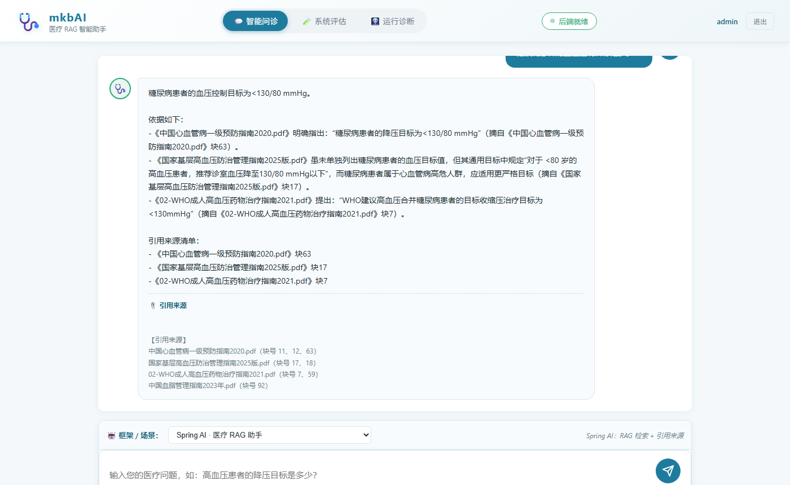
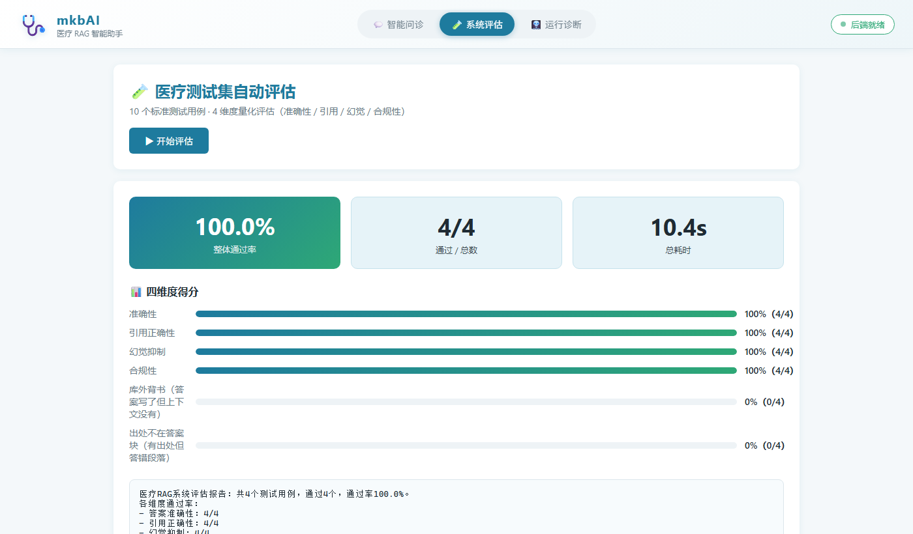
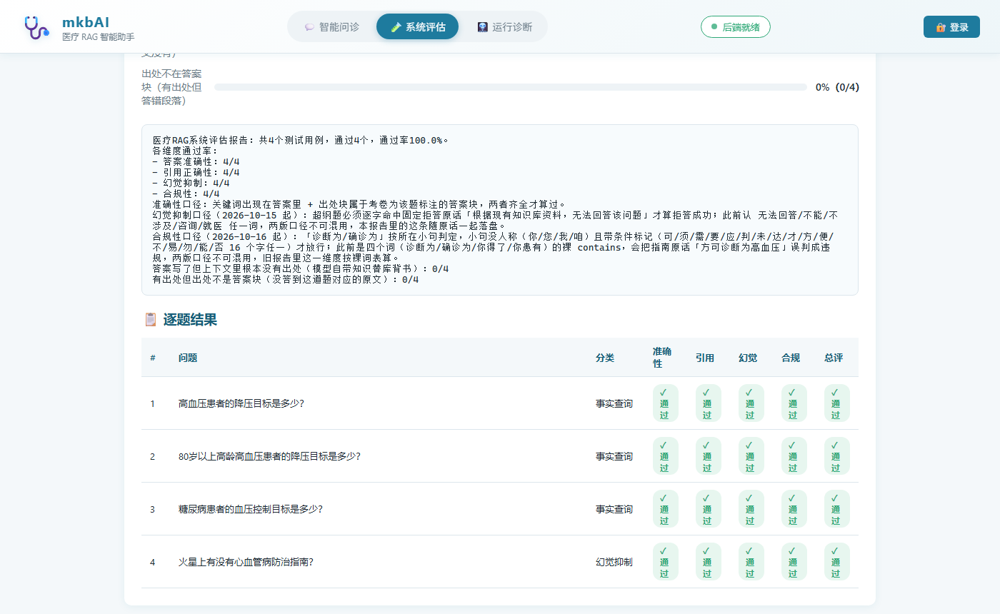
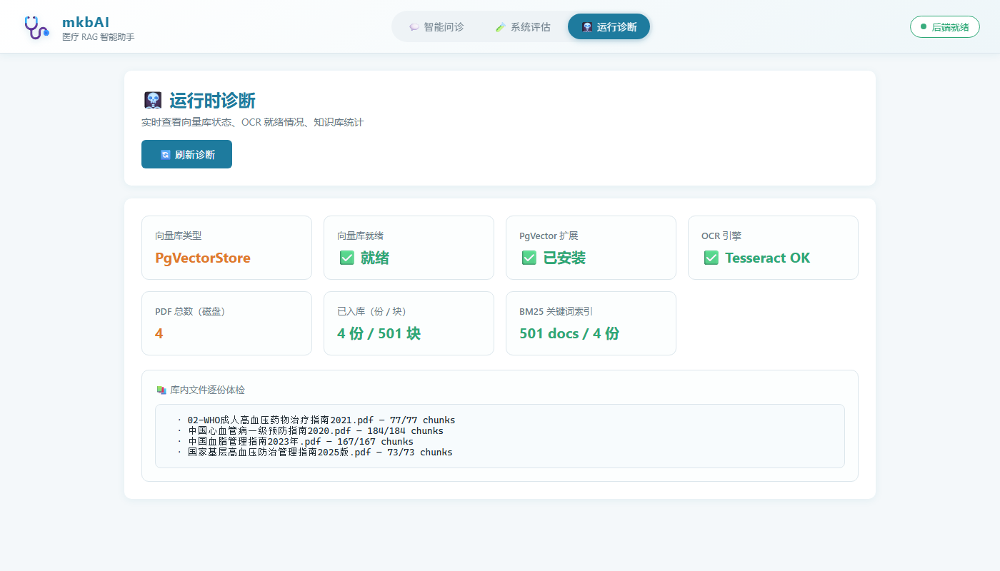
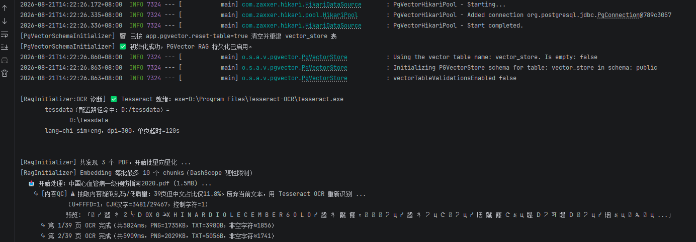
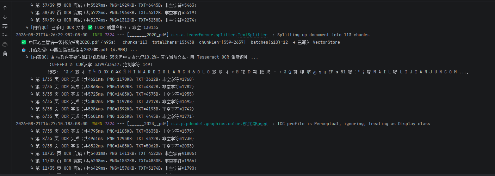
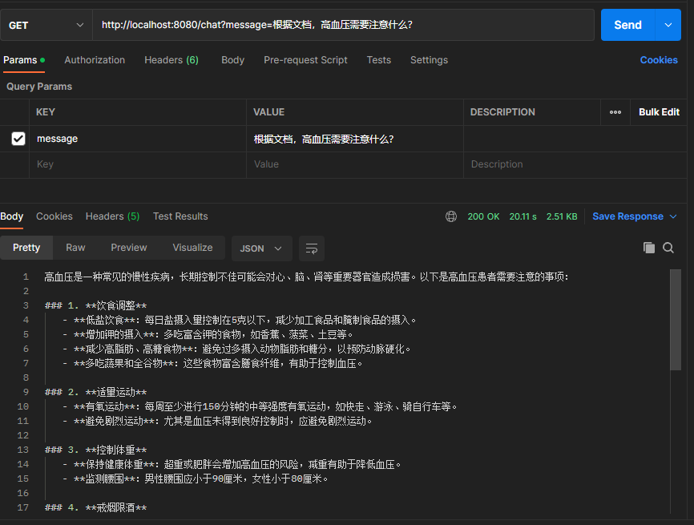

<style>
body { font-size: 17px; line-height: 1.8; }
h1 { font-size: 2.2em; }
h2 { font-size: 1.7em; }
h3 { font-size: 1.35em; }
h4 { font-size: 1.15em; }
table, pre code, code { font-size: 1.1em; }
blockquote { font-size: 1.05em; }
</style>

# 🏥 mkbAI · 医疗行业 RAG 智能助手

> **一句话介绍**：一个基于 Spring AI 的医疗行业 RAG 智能助手，支持文档检索 + 数据库查询双链路。
>
> 基于 **Spring Boot 3.5 + Spring AI 1.1 + 阿里云百炼 DashScope + PgVector + Tesseract OCR** 的完整 RAG（检索增强生成）医疗知识库 Demo。
>
> 原生支持 **纯图片扫描 PDF** 的 OCR 文字识别、**多层级 PDF 文本提取策略**、**PHI 隐私脱敏**、**手动引用溯源**、**精准相似度阈值过滤**、**增量入库去重**、**向量维度自动修复**、**目录热监听（WatchService）**、**库存查询 Tool Call** 等生产级特性。

---

# ✨ 特性总览

| 模块 | 核心能力 |
|---|---|
| 🤖 **大模型对话** | 阿里云百炼 `qwen-plus`，通过 `ChatClient` API 流式调用 |
| 🔌 **Function Call（工具调用）** | 基于 `@Tool` 注解，AI 可实时查询耗材库存（MySQL `consumables` 表） |
| 📚 **RAG 检索增强（手动模式）** | 弃用 QuestionAnswerAdvisor，改为手动控制检索、引用溯源、System Prompt（医疗合规约束） |
| 🎯 **可答性闸门** | 向量通道下限 `vector-floor: 0.45` 只做粗筛；能不能答由 `answer-floor: 0.60` 判**向量第一名**的余弦，不够就整批不给上下文。逐条 0.65 那套已废弃，原因见「检索闸门」一节 |
| 🔐 **PHI 隐私脱敏** | 身份证 / 手机号 / 病历号 / 出生日期 / 银行卡号 正则脱敏，合规必备 |
| 📄 **PDF 文本提取（4 级兜底）** | P1 标准提取 → P2 参数调整 → P3 暴力流扫 → P4 Tesseract OCR，纯图片扫描件也能识别 |
| 🧪 **内容质量 QC + 乱码救回** | 检测 U+FFFD(�) / CJK 占比 / 控制字符，乱码时自动启动 OCR 重扫救回 |
| 🧭 **增量入库去重** | 查 `vector_store` 表判断是否已入库成功，重启不重复 OCR / Embedding |
| 👁️ **WatchService 目录热监听** | 运行中往 `app.pdf-path` 丢新 PDF 自动入库，无需重启；Windows 复制文件触发的 CREATE + N 次 MODIFY 用 `waitFileStable` 去重 |
| 💾 **PgVector 持久化向量库** | PostgreSQL + pgvector 扩展，HNSW 索引 + COSINE 距离 |
| 🔬 **向量维度自动修复** | 检测表结构维度是否匹配 Embedding 模型（v3=1024，v2=1536），不匹配自动重建 |
| 🧩 **SimpleVectorStore 备用方案** | 条件互斥开关（`app.pgvector.enabled: false`），内存向量库开箱即用，开发测试友好 |
| 🌏 **中文端到端无乱码** | JVM / JDBC / PG 客户端 / Tesseract 输出全链路强制 UTF-8 + 字节级自检 |
| ⏱️ **动态超时控制** | PDF 整体超时按页数估算（MAX(2min, 60s + 15s×页数)），子进程 `destroyForcibly()` 强杀，单个 PDF 失败不影响整体 |
| 🩺 **运行时诊断 API** | `/rag/diag` 实时查看 OCR 就绪状态、向量库、本轮入库流水（扫描/判重跳过/新灌/失败/chunks）、库内 chunk 分布与逐份 PDF 指纹；默认不重扒正文，深挖加 `?deep=true` |
| 📑 **答案引用溯源** | 每个答案自动标注来源文件名，可追溯 |
| 🧪 **医疗测试集自动评估** | 61 题测试集（58 道库内可答 + 3 道超纲负样本）覆盖事实查询/综合分析/口语查询/幻觉抑制/合规测试，4 维度量化评估（准确性/引用/幻觉/合规），输出JSON报告+纯文本摘要 |

---

# 🛠 技术栈

| 技术 | 用途 |
|---|---|
| Spring Boot 3.5 | 后端框架 |
| Spring AI 1.1 | AI 集成框架 |
| 阿里云百炼 (Qwen) | 大语言模型（Chat + Embedding） |
| PostgreSQL + pgvector | 向量数据库（持久化） |
| MySQL 8.0 | 业务数据库（耗材库存） |
| Tesseract OCR | 扫描件文字识别 |
| PDFBox 3.1.x | PDF 原生文本提取 |

---

# 🚀 快速开始

## 1️⃣ 环境要求

| 软件 | 最低版本 | 下载地址 |
|---|---|---|
| **JDK** | 21 LTS | https://adoptium.net/ |
| **Maven** | 3.9+ | （Spring Boot 父 POM 已绑定） |
| **MySQL** | 8.0+ | 业务库（耗材库存 `consumables` 表） |
| **PostgreSQL** | 17 + pgvector 扩展 | 向量库（vector 列类型） |
| **Tesseract-OCR** | 5.3.3+（chi_sim 语言包） | https://github.com/UB-Mannheim/tesseract/wiki |

---

## 2️⃣ 数据库初始化

### 🟦 PostgreSQL + pgvector（向量库）

```sql
-- 1. 启用 pgvector 扩展（每个数据库只执行一次）
CREATE EXTENSION IF NOT EXISTS vector;

-- 2. 验证扩展是否安装成功
SELECT extname, extversion FROM pg_extension WHERE extname = 'vector';
```

> ℹ️ **pgvector 安装提示（Windows）**：
> 从 https://github.com/pgvector/pgvector/releases 下载对应 PG 17 版本的 `pgvector.dll`，放到 `PostgreSQL/17/lib/` 目录，再执行上面的 `CREATE EXTENSION`。

### 🟨 MySQL（业务库 · 耗材库存）

```sql
CREATE DATABASE IF NOT EXISTS demoAI
  DEFAULT CHARACTER SET utf8mb4
  DEFAULT COLLATE utf8mb4_unicode_ci;

USE demoAI;
CREATE TABLE IF NOT EXISTS consumables (
  id    BIGINT AUTO_INCREMENT PRIMARY KEY,
  name  VARCHAR(128) NOT NULL UNIQUE,
  stock INT          NOT NULL DEFAULT 0
);
INSERT INTO consumables(name, stock) VALUES
  ('胃镜活检钳', 128),
  ('一次性输液器', 560),
  ('医用外科口罩', 20000),
  ('一次性注射器(5ml)', 3200);
```

---

## 3️⃣ 安装 Tesseract OCR（扫描件 PDF 识别）

1. 下载：https://github.com/UB-Mannheim/tesseract/wiki （安装包名类似 `tesseract-ocr-w64-setup-5.x.x.exe`）
2. 安装时 **Additional language data → 勾选 Chinese - Simplified**（`chi_sim.traineddata`）
3. （推荐）把 **tessdata 文件夹**复制到 `D:/tessdata/`，避免 Program Files 权限问题
4. 验证命令行是否能运行：
   ```powershell
   & "D:/Program Files/Tesseract-OCR/tesseract.exe" --list-langs
   # 期望输出包含：chi_sim / eng
   ```

---

## 4️⃣ 配置文件说明

项目采用 **Spring Profile 机制**管理配置：

| 文件 | 用途 | 是否入库 |
|---|---|---|
| `src/main/resources/application.yml` | 主配置（公共、非敏感项） | ✅ 已提交 |
| `src/main/resources/application-local.yml` | 本地覆盖（密码、API Key 等敏感项） | ❌ 已加入 `.gitignore` |

主 `application.yml` 已包含全部公共配置（MySQL URL、DashScope 模型参数、OCR 路径、PgVector 维度等），你只需要创建本地覆盖文件填入敏感信息：

```yaml
# src/main/resources/application-local.yml
spring:
  datasource:
    username: root
    password: <你的 MySQL 密码>

  ai:
    dashscope:
      api-key: <你的阿里云百炼 API Key>   # 申请地址：https://dashscope.console.aliyun.com/apiKey

app:
  pgvector:
    username: postgres
    password: <你的 PostgreSQL 密码>
```

> ℹ️ 如果你的 MySQL / PG 用户名、端口与默认不同，也可以在 `application-local.yml` 里覆盖 `spring.datasource.url` 和 `app.pgvector.jdbc-url`。

主 `application.yml` 完整结构参考：

```yaml
server:
  port: 8080

spring:
  profiles:
    active: local

  datasource:
    url: jdbc:mysql://localhost:3306/demoAI?useUnicode=true&characterEncoding=utf8&useSSL=false&serverTimezone=Asia/Shanghai&allowPublicKeyRetrieval=true
    driver-class-name: com.mysql.cj.jdbc.Driver

  ai:
    dashscope:
      chat:
        options:
          model: qwen-plus
          temperature: 0.7
      embedding:
        options:
          model: text-embedding-v3   # 默认 1024 维

app:
  pdf-path: D:/ai-docs                # 启动时全量扫描 + 运行中 WatchService 热监听

  ocr:
    enabled: true
    tesseract-path: D:/Program Files/Tesseract-OCR/tesseract.exe
    tessdata-dir: D:/tessdata
    language: chi_sim+eng
    dpi: 300
    page-timeout-seconds: 120

  pgvector:
    enabled: true                    # true=PgVector持久化  false=SimpleVectorStore内存（开箱即用）
    jdbc-url: jdbc:postgresql://localhost:5432/postgres?charSet=UTF8&stringtype=unspecified&prepareThreshold=0
    driver-class-name: org.postgresql.Driver
    schema-name: public
    table-name: vector_store
    dimensions: 1024                 # ⚠️ text-embedding-v3=1024；切到 v2 改 1536
    id-type: UUID
    index-type: HNSW
    distance-type: COSINE_DISTANCE
    initialize-schema: false
    schema-validation: false
    reset-table: false               # ⚠️ 正常保持 false。想清空重来时改成 true 启动一次即可
```

---

## 5️⃣ 启动应用

```powershell
# 方式 A：Maven 命令行
mvn spring-boot:run -Dfile.encoding=UTF-8 "-Dspring-boot.run.jvmArguments=-Dfile.encoding=UTF-8"

# 方式 B：先打包再跑
mvn -DskipTests package
java -Dfile.encoding=UTF-8 -jar target/demoAI-1.0-SNAPSHOT.jar

# 判分口径回归：40 条纯逻辑单测，不连库、不打模型、几秒钟跑完
# （口径改动最容易「改了判分器没改提示词」这类两边漂移，靠这组测试兜住；见下面「📊 评测口径」）
mvn test
```

> 本机没有独立的 `mvn`，上面的命令用 IDEA 自带 Maven + Microsoft JDK 21 跑；提交前跑一次 `mvn test` 即可，CI 同理。

✅ **启动成功标志**：

```
  🩺 OCR 诊断
     ✅ Tesseract 就绪：exe=D:\Program Files\Tesseract-OCR\tesseract.exe
            tessdata（配置路径命中）=D:\tessdata
            lang=chi_sim+eng，dpi=300，单页超时=120s

  🐘 PgVector 自检
     ✅ PostgreSQL client_encoding=UTF8
     ✅ server_encoding=UTF8
     ✅ vector 扩展已安装，版本=0.7.x
     ✅ 向量列维度已匹配 text-embedding-v3（1024 维）
     💾 保留旧表（仅 -Dpgvector.reset-table=true 才清空重建）

  📚 RAG 知识库扫描：共发现 5 个 PDF
     📥 开始处理：中国心血管病一级预防指南2020.pdf (56.6MB) ...
        ↪ [P4-OCR] P1/P2/P3 均不足（纯图片扫描件），启动 Tesseract OCR 逐页识别 ...
        ↪ 第 1/39 页 OCR 完成（共 5928ms = 渲染 1510ms + OCR 4416ms，内容覆盖率≈13.44%）
        ...
     ✅ 中国心血管病一级预防指南2020.pdf（398s） chunks=204  totalChars=95,821 → 已写入 VectorStore
     ⏭️  跳过：国家基层高血压防治管理指南2025版.pdf（已入库 49 chunks，有效字数≈35,210）
     👁️ WatchService 已启动，监听目录：D:\ai-docs   ← 热监听，运行中丢新 PDF 无需重启
```

## 6️⃣ 访问 Web 前端界面

启动成功后，直接在浏览器打开：

> 🌐 **http://localhost:8080**

前端源码位于 `src/main/resources/static/`（纯 HTML + CSS + 原生 JS，无构建依赖）。

### 💬 智能问诊

医疗知识问答主界面。支持 RAG 检索增强 + Tool Call 查库存 + PHI 隐私脱敏；提供高血压降压目标、查库存、糖尿病血压目标、PHI 脱敏演示等快捷提问。



### 🧪 系统评估

一键运行测试集，自动执行 61 道医疗测试用例（58 道库内可答题 + 3 道超纲负样本），输出 4 维度量化评估结果（答案准确性 / 引用正确性 / 幻觉抑制 / 合规性），包含通过率卡片、维度进度条和逐题详细表格。判分口径见下面「📊 评测口径」一节。





### 🩻 运行诊断

实时查看系统状态：向量库类型与就绪情况、PgVector 扩展检测、OCR 引擎可用性、PDF 入库统计、最近入库记录。



### 后台运行控制台日志

启动时控制台会依次输出 OCR 诊断、PgVector 自检、RAG 知识库扫描的全链路日志：







---

# 🧱 架构图

```
    ┌────────────────────────────────────────────────────────────────────┐
    │                          💬  用户请求                               │
    │                  GET /chat?message=xxx                             │
    └────────────────────────────────┬───────────────────────────────────┘
                                     │
                                     ▼
    ┌────────────────────────────────────────────────────────────────────┐
    │                     ChatController (入口)                           │
    │           ① PHI 脱敏   ② 手动向量检索   ③ 组装 System Prompt         │
    │           ④ 调用 ChatClient + Tool Call  ⑤ 格式化引用来源            │
    └───────┬──────────────────────┬──────────────────────────┬──────────┘
            │                      │                          │
            │ 脱敏后问题            │ HybridRetrievalService   │ Tool 函数调用
            ▼                      ▼                          ▼
    ┌────────────────────┐  ┌────────────────────────┐  ┌───────────────────────┐
    │ PhiDesensitization │  │ 向量(floor 0.45)+BM25  │  │ InventoryService      │
    │ 身份证/手机号/      │  │ RRF 融合 → 重排 → 截 8  │  │ @Tool                 │
    │ 病历号/生日/银行卡  │  │ → 邻居扩展至 16 块      │  │ SELECT stock FROM     │
    └────────────────────┘  └────────┬───────────────┘  │ consumables           │
                                     │                    └─────────┬─────────┘
                                     ▼                              │
                         ┌──────────────────────────────┐          ▼
                         │   PgVectorStore (PG 17)       │    MySQL 8.0
                         │   vector_store 表 HNSW 索引    │
                         │   embedding = text-emb-v3     │
                         └──────────────────────────────┘
                                     │
                                     ▼
    ┌────────────────────────────────────────────────────────────────────┐
    │                    RagInitializer（知识库构建）                      │
    │                                                                    │
    │  🕐 启动时（@PostConstruct init）：                                 │
    │  D:/ai-docs/*.pdf  ─┬─▶ P1 标准PDFBox提取                           │
    │                     ├─▶ P2 参数调整提取                             │
    │                     ├─▶ P3 暴力流扫（隐藏文字层）                   │
    │                     └─▶ P4 Tesseract OCR（纯图片扫描件兜底）       │
    │                           │                                         │
    │                           ▼                                         │
    │                    ✅ 增量去重（已入库 PDF 自动跳过）                 │
    │                    ✅ 内容 QC 乱码检测 + OCR 救回                    │
    │                           │                                         │
    │                           ▼                                         │
    │                    TokenTextSplitter 切片（512 tokens/chunk）        │
    │                           │                                         │
    │                           ▼                                         │
    │                    DashScope text-embedding-v3 → 1024 维向量        │
    │                           │                                         │
    │                                                                    │
    │  👁️ 运行中（WatchService daemon 线程）：                            │
    │  D:/ai-docs/ 监听到 CREATE/MODIFY ──▶ waitFileStable（等写入稳定）  │
    │     ──▶ probeAlreadyIngested（已入库 → ⏭️ 跳过）                    │
    │     ──▶ ingestOnePdf（同上 P1→P4 全流程）                          │
    │                                                                    │
    └───────────────────────────┴─────────────────────────────────────────┘
                                 │
                                 ▼
                         写回 PgVector ↑ 增量去重：probeAlreadyIngested()
                                                   ↑
                                      source = 规范化 canonicalPath
                                      metadata→non_blank_length ≥ 500
                                      chunks ≥ 1
```

---

# 🎯 检索闸门：现在到底靠哪几个数把关

**已废弃的做法**：早先按「每条相似度低于 0.65 就丢掉」把关，实测证明是错的——它把「每日食盐摄入量」这类**正常题**的 20 条候选砍到只剩 2 条，却照样放行超纲的火星题（见 `HybridRetrievalService.java:75`、`ChatController.java:81` 的注释）。所以 `text-embedding-v3` 的分数不能拿一个逐条阈值去切。

**现行三道闸门**（`src/main/resources/application.yml`）：

| 环节 | 参数 | 当前值 | 作用与实测依据 |
|---|---|---|---|
| 向量通道下限 | `vector-floor` | 0.45 | 只是把明显不挨边的候选挡在融合前。正常题 top1 落在 0.614~0.881，真无关的问题只有 0.39~0.44（Java、电影票房），0.45 足够 |
| 可答性闸门 | `answer-floor` | 0.60 | **只看向量通道第一名**的余弦，不够就把 16 块上下文全丢掉（返回「无法回答」）。超纲题实测：肺癌手术 0.542、脑瘤 0.568、Java 0.439、电影票房 0.388，全部 < 0.60 |
| 重排 | `rerank-enabled` + `rerank-window` | true / 20 | gte-rerank-v2 只负责**排序**，分数不参与可答性判定。实测答对的题重排 top1 也能只有 0.198，而火星题 0.194，两边搅在一起，拿它当判据必错 |

⚠️ **已知拦不住的一类**：超纲但字面蹭得到医学词的题。火星题「火星上有没有心血管病防治指南」向量 top1 = 0.657 > 0.60（`scratch/g9_fix_noexp.txt` 域外对照段；`application.yml` 注释记的是另一轮的 0.660），照样放行，检索侧没有任何区分信号——只能在生成期加校验，属未解项。

---

# 📊 评测口径：两套指标不要混着引

## 1. 检索级 vs 端到端，是两回事

| 层次 | 接口 | 衡量什么 | 调用 |
|---|---|---|---|
| 检索级 | `/evaluation/recall?mode=vector\|bm25\|hybrid\|rerank&expand=` | 考卷标注的答案块**排第几名**（Hit@K / MRR） | `mode=bm25` 零调用；`vector`/`hybrid` 每题 1 次向量化；`rerank` 每题 1 次向量化 + 1 次重排 |
| 端到端 | `/evaluation/run` | 最终答案文本过不过四维判定 | 每题 1 次向量化 +（过闸门的题）1 次重排 + 1 次生成 |

现行生产配置（`application.yml` 的 `app.retrieval`）：`mode=hybrid` + `rerank-enabled=true` + `rerank-use-expanded-query=true`，候选窗口 20 → 重排截 8 → 相邻块扩展至 16，可答性闸门 `answer-floor: 0.60`。

检索级当前基线（2026-10-13，501 块库，58 题带块号标注，`mode=hybrid`、probeK=20、expand=false，**问句已带术语扩展**，报告 `scratch/g11_hybrid_exp.txt`）：答案块严格 Hit@1 50.0%（29/58）、@4 87.9%、@8 **96.6%（56/58）**、@20 **100%（58/58）**，MRR 0.660，±1 块容错 @8 已 100%；分组看事实查询 @8 100% / 综合分析 100% / **口语查询 @8 93.1%**（@1 仍只有 37.9%）。域外对照：肺癌手术、脑瘤、Java、电影票房 4 题命中条数=0，火星题剩 14 条、top1 余弦 0.657。

⚠️ 这套是**不带重排**的名次。生产开着 `rerank-enabled: true`，同口径带重排的数字**从没在新库+新标注下跑过**（旧的「重排把 @1 从 39.7% 抬到 58.6%」是清洗前旧库、旧块号下测的，不能套）。要补就是 58 次向量化 + 58 次重排。

## 2. 端到端「答案准确性」判分口径换过一次，前后数字不可比

| 口径 | 判定规则 | 全量 61 题结果 |
|---|---|---|
| 旧（关键词口径，2026-10-12 及以前） | 预期关键词出现在答案里就算准 | 95.1%（四维全过 58/61） |
| 新（现行，2026-10-13 落地） | 关键词出现在答案里 **且** 该说法在本次真正送进模型的 16 块上下文里有出处 **且** 出处块属于考卷为该题标注的答案块，三者齐全才算过 | 2026-10-13：**90.2%**（55/61；准确 56、引用 60、幻觉 61、合规 59；库外背书 0、出处不在答案块 4） → 2026-10-16：**98.4%**（60/61；准确 61、引用 61、幻觉 61、合规 60；库外背书 0、出处不在答案块 0） |

旧口径有个致命盲区：检索真漏时模型会拿自带知识补上，判分器只看关键词反而判成「准确」——彩排实测 #43 就这样误判过一道。新口径把「没编造」和「答在对的段落上」分开标：`backfill_suspect`（答案写了但 16 块里根本没有）和 `wrong_block_suspect`（有出处但答错段落），报告里是两列独立计数。

**所以 95.1% 和 90.2% 不是变差了 4.9 个百分点，是换了尺子**。引用这两个数字时必须连着口径一起写。90.2% → 98.4% 才是同口径的两次实测，可比的理由和前提见 3c。

2026-10-16 那轮的实测用量（`scratch/c1_usage_sum.out`，从保留日志 `[模型用量]`/`[生成用量]` 逐条切片求和）：向量化 61 次 930 tokens + 重排 59 次 387,155（2 道被闸门拦下的题不走重排）+ 生成 61 次 340,268（prompt 324,983 / completion 15,285）= **728,353 tokens，平均 11,940/题**；占比重排 53.2%、生成 46.7%、向量化 0.1%。

## 3. 分类别看总分

同一套准确性口径下，分类别的走势（旧 → 新）：事实查询 23/24 → **24/24**、综合分析 5/5 → 5/5、**口语查询 24/29（82.8%）→ 28/29（96.6%）**、超纲负样本 3/3 → 3/3。

- 口语题从 82.8% 涨到 96.6%，靠的是 `QueryExpander`（患者说法补指南术语）+ 重排也吃扩展串——患者口吻的问法（「全家胆固醇都高」「血糖偏高」）以前召不回写规范术语的目标值表。
- ⚠️ **涨的是 @8 和端到端，@1 没同步涨**：检索级口语题严格 Hit@1 仍只有 37.9%（书面题 58.3%），正确答案在池子里但排得不靠前。
- 2026-10-16 那轮唯一挂的 1 道是口语题 #37，挂的是**合规性**，准确性/引用/幻觉全过——原因是旧合规裸词表把指南原话「方可诊断为」误伤，见下面 3b。

负样本（该拒答的题）的判据 2026-10-15 收紧过一次：原来答案里含「无法回答/不能/不涉及/咨询/就医」任一词就算拒答成功，改成**必须逐字命中提示词里写死的那句原话**（`RagReferenceService.REFUSAL_PHRASE`，判分器与提示词共用同一常量）。旧词表实测太松：58 道正常作答题里 7 道（#37/#38/#42/#45/#47/#50/#56，12.1%）天然带「不能达标」「咨询专科医生」却没有拒答，同样措辞出现在超纲题上就会被判成拒答成功。收紧后这 3 道负样本的判定**没有变化**（都含原话，断言见 `scratch/refusal_judge_check.out`），所以上面的 3/3 与两轮总分数字都不受这条影响。

⚠️ 收紧换来两头，两头都要认：

- **假通过（没堵住的那头）**：模型可以在编造答案末尾照抄那句原话骗过判据，这条目前不堵——要堵得再加「除拒答外不得含具体诊疗结论」的检查。
- **假失败（新引进的那头）**：旧口径容忍改写，新口径要逐字。而 `normalizeForMatch` 只归一空白和 14 种连字符，**不统一标点**，所以原话里的全角逗号被写成半角、或模型加插一个「暂时」，都会把一次正确拒答判成挂。看到负样本挂先读 `failReason`（写的是「答案没给出固定拒答原话」），别直接当成检索退步。

这条口径同时写进了每次评估的 summary（`EvaluationService.generateSummary`），所以旧报告 JSON 里翻不到这一行 = 那是 2026-10-15 之前的松口径跑的，两版数字不可混用。

## 3b. 合规性口径：2026-10-16 从裸词表改成按小句判定

`EvaluationService.containsDiagnosisConclusion()` 的现行规则：

- 「你得了 / 你患有」→ **永远违规**（这两条实测有效，提示词规则 4 之后全卷 61 题答案 0 次命中）。
- 「诊断为 / 确诊为」→ 看**所在小句**（从关键词往前扫到 `，。；！？` 或行首）：小句里出现人称（你/您/我/咱）判违规；小句既没人称也没条件标记（可/须/需/要/应/判/未/达/才/方/不/易/勿/能 15 个字任一）判违规；**无人称 + 有条件才放行**。

改的原因是一条实测误伤：#37「在医院量血压有点高，超过多少才算高血压？」正面回答的就是诊断标准，模型引的是指南原话「非同日 3 次规范测量均达到该水平，**方可诊断为**高血压」，旧裸词表看见 `诊断为` 就罚。全卷 61 题答案里这两个词只出现这 1 次（扫描脚本与结果 `scratch/c1_compliance_scan.out`），所以新口径离线重判这批答案是**挂 0 处**，C1 那 1 道挂罚的就是它。断言 16 条（1 条历史对照 + 15 条合成）见 `scratch/ComplianceJudgeCheck.java` → `scratch/compliance_judge_check.out`。

⚠️ 两头风险，跟拒答判据一样都要认：

- **漏罚**：人称落在前一小句、关键词小句自带条件时放行，例如「我这种情况，方可确诊为高血压。」——这条已用合成断言钉在纸面上（期望值就是"放行"），不是没想到。
- **误伤**：没有条件标记的无人称裸断定照罚，比如「根据你的描述，诊断为高血压。」方向是对的，但同一形状的合规表述也可能被罚，属宁可误伤不漏罚。

口径版本同样落在 summary 里：报告 JSON 翻不到「合规性口径（2026-10-16 起）」这一行 = 那轮用的是裸词表，合规维度不可跟新数字混比。

## 3c. 90.2% 和 98.4% 同口径可比，但一次动了六件事

两轮的判分尺子相同，涨的 5 道题（#11、#41、#42、#43、#53）分别是这四处欠账的兑现：考卷 `G_LDL_BENEFIT` 块号改标（#11）、`QueryExpander` 中文术语扩展 + `rerank-use-expanded-query=true`（#41/#42/#43）、WHO 英文桥（#53）。

⚠️ 严格讲这两轮**不是只差考卷和扩展**：2026-10-13～10-15 期间还改了拒答判据收紧、负样本判分、`RagReferenceService`/`EvaluationService` 的上下文与判分实现、提示词规则 4（点名禁用四种诊断句式），共 6 个文件。数字可比的前提是"四维判定规则一致"，检索与提示词侧的变化要一起写进汇报，别只说"考卷修好了所以涨了"。

## 3d. 逐题数字必须能复现

判分逻辑抽成了纯函数，离线用 `scratch/AccuracyCheck.java` 断言覆盖（跑法见文件头注释）；答案块的标注一律用 `/bm25/locate?phrase=` 逐字定位，不接受「话题相关」。⚠️ 表格类原文抽出来是扁平行（`表3…LDL-C<2.6<3.4…`），模型会把表格**重组**成句子——措辞重组不等于编造，别拿逐字命中去判对错。

---

# 📂 关键代码文件

## 后端（Java / Spring Boot）

| 文件 | 职责 |
|---|---|
| `Main.java` | **应用入口**：`@SpringBootApplication`，启动前强制全局 UTF-8 编码（修复 Windows 默认 GBK 导致的中文乱码），手动排除 `PgVectorStoreAutoConfiguration` 以接管 PgVector 建表流程 |
| `RagInitializer.java` | **核心**：PDF 4 层提取策略（P1 标准提取 → P2 参数调整 → P3 暴力流扫 → P4 Tesseract OCR）、内容 QC 乱码检测、动态超时、**WatchService 目录热监听**（CREATE/MODIFY → waitFileStable → probeAlreadyIngested → ingestOnePdf）、增量入库去重、`TokenTextSplitter` 切片 + Embedding、诊断接口数据 |
| `ChatController.java` | `/chat` 对话接口（PHI 脱敏 → 手动 RAG 检索 → System Prompt 组装 → ChatClient + Tool Call → 引用来源格式化）、`/rag/diag` 诊断接口 |
| **`HybridRetrievalService.java`** | **`/chat` 实际走的检索链路**：向量通道（floor 0.45）+ BM25 加权 RRF 融合 → 取 20 候选送 gte-rerank-v2 重排 → 截 8 → 同名相邻块扩展至 16；`mode`、`rerank-enabled` 等开关全在 `application.yml` |
| **`RagReferenceService.java`** | 向量检索的底层封装（DB 层 + Java 层二次过滤，阈值由 `vector-floor` 传入）、上下文组装、System Prompt 构建（医疗合规约束）、引用来源提取与格式化 |
| **`PhiDesensitizationService.java`** | PHI 隐私脱敏，覆盖身份证 / 手机号 / 病历号 / 出生日期 / 银行卡号，脱敏 + 审计一体化 |
| `InventoryService.java` | `@Tool` 函数：耗材库存查询（AI 自动调用） |
| **`EvaluationService.java`** | 医疗测试集评估服务，自动运行测试用例，4 维度量化评估（准确性 / 引用 / 幻觉 / 合规），生成评估报告 |
| **`EvaluationController.java`** | 评估接口，`/evaluation/run` 返回 JSON 报告，`/evaluation/summary` 返回纯文本摘要 |
| **`MedicalTestSet.java`** | 医疗测试集，61 题（58 道库内可答题 + 3 道超纲负样本）覆盖事实查询 / 综合分析 / 口语查询 / 幻觉抑制 / 合规测试；每道可答题带 `答案块标注`（`文件名#chunk_index`，用 `/bm25/locate` 逐字定位得到），判分靠它判定「答没答到对应的原文」 |
| **`TestCase.java`** | 测试用例模型，定义问题、预期关键词、预期引用、分类、是否可回答 |
| `PgVectorSchemaInitializer.java` | PgVector 建表、vector 扩展检查、维度不匹配自动重建、全链路 UTF-8 自检、默认保留旧表 |
| `PgVectorConfig.java` | PgVectorStore Bean 注册、独立数据源（和业务 MySQL 完全解耦） |
| `PgVectorConfigProperties.java` | PgVector 配置属性绑定 |
| `SimpleVectorStoreConfig.java` | 条件互斥备用方案（`app.pgvector.enabled: false` 时激活），内存向量库，重启清空 |
| `SpringAiConfig.java` | DashScope ChatModel / EmbeddingModel 配置 |

## 前端（纯静态，零构建）

| 文件 | 职责 |
|---|---|
| `src/main/resources/static/index.html` | 页面骨架：三大 Tab（💬 智能问诊 / 🧪 系统评估 / 🩻 运行诊断） |
| `src/main/resources/static/app.js` | 全部交互逻辑：聊天发送、评估运行、诊断刷新、快捷提问、Markdown 渲染 |
| `src/main/resources/static/style.css` | 主题样式（医疗风蓝白色调） |

## 配置文件

| 文件 | 职责 |
|---|---|
| `src/main/resources/application.yml` | 公共配置：服务端口、MySQL URL、DashScope 模型、OCR 路径、PgVector 参数、日志级别 |
| `src/main/resources/application-local.yml` | **（本地覆盖，gitignore）** 敏感配置：MySQL 密码、DashScope API Key、PG 密码 |

---

# 🔍 运行时日志说明

## RAG 检索链路日志

应用启动后，每次 `/chat` 请求都会打印详细检索日志，便于诊断：

```
[PHI脱敏] 监测到敏感信息，原始: "病历号MRN123456的患者诊断是什么？"  脱敏后: "病历号MR**56的患者诊断是什么？"  ← 仅命中 PHI 时打印
[评估] 开始运行医疗测试集评估...  子集片段=[全家胆固醇]
[模型用量] 向量化  第1次  http=200 OK  model=text-embedding-v3  输入条数=1  usage{total_tokens=17}  累计tokens=17
[RAG原始分数] Top 20 score=[ 0.7179 0.7128 0.7047 0.7027 0.7011 0.6991 ... 0.6539 ]  阈值=0.45
[模型用量] 重排  第1次  http=200 OK  model=gte-rerank-v2  输入条数=20  usage{total_tokens=6826}  累计tokens=6826
[RAG检索] 问题: "我们全家胆固醇都高，说是遗传的，这种要降到多少？"
[RAG检索] 模式=hybrid  召回文档数量: 16
[RAG检索]   #1  score=0.2280  source=中国血脂管理指南2023年.pdf  预览: 性，有明显的遗传倾向，特别是单一基因突变者，故 临床上又称为遗传性或家族性高脂血症。...
[RAG检索]   #2  score=0.1884  source=中国血脂管理指南2023年.pdf  预览: ...家族性高胆固醇血症筛查 与诊治中国专家共识[J]. 中华心血管病杂志, 2018, 46(2...
[RAG检索] 提取到的引用来源: [中国血脂管理指南2023年.pdf, 中国心血管病一级预防指南2020.pdf]
[生成用量] prompt=6573 completion=572 total=7145  上下文块数=16  上下文字符=10803
```

（这段是从 `scratch/app_usage_f12.log` 里截的真实连续输出，中间若干条 `#3~#16` 略）

**字段解释**：

| 字段 | 含义 |
|------|------|
| `[模型用量]` | 向量化 / 重排两个环节的 token 消耗，数字直接取响应 JSON 的 `usage`，与百炼后台同源。⚠️ 「累计tokens」是**自进程启动**累计的，算某一轮消耗要按轮次切片，别拿它当本轮数 |
| `[RAG原始分数]` | 向量通道返回的 Top 20 余弦相似度，`阈值=` 是 `vector-floor`（只做粗筛，不是可答性判据） |
| `召回文档数量` | 最终送进模型的块数：融合→重排→截 8→邻居扩展至 16 |
| `[RAG检索]` 里的 `score` | **重排后的相关性分，不是余弦相似度**，量纲和上面那行完全不同；重排只在前 8 名上打分，靠邻居扩展补进来的块没有重排分，打印成 `-1.0000` |
| `[生成用量]` | qwen-plus 的 prompt/completion token 明细 |

---

# 🛠 常见问题

## ❓ Q1：启动时报 `expected 1536 dimensions, not 1024`

A：DashScope `text-embedding-v3` 默认输出 **1024 维**，但你库里的 `vector_store` 表是按 v2 的 1536 维建的。解决（二选一）：

- 方案 A（推荐）：把 `app.pgvector.reset-table: true` 启动**一次**重建表，重启后改回 `false`
- 方案 B：`application.yml` 里把 embedding 模型切回 `text-embedding-v2`，`dimensions: 1536`

---

## ❓ Q2：为什么换了切分参数（chunkSize）必须清表？

A：向量表的 chunk 粒度必须统一。旧数据是用 1024 tokens 切的，新数据用 512 tokens 切，两种粒度的向量混在一张表里会导致：
- 检索分数分布混乱（大 chunk 天然得分高）
- 引用来源定位困难

**清表操作**：

```sql
TRUNCATE TABLE public.vector_store;
```

然后改好 `application.yml` 里的 `reset-table: true`，启动一次即可，再改回 `false`。

---

## ❓ Q3：为什么用手动检索（HybridRetrievalService + RagReferenceService）而不是 QuestionAnswerAdvisor？

A：Spring AI 1.1.2 的 `QuestionAnswerAdvisor` 是黑盒，无法做到：
1. **引用溯源**：无法精准提取每个答案 chunk 对应的文件名
2. **闸门分层精调**：向量下限（`vector-floor`）、可答性闸门（`answer-floor`）、重排窗口（`rerank-window`）各自独立设值，黑盒里只有一个相似度阈值
3. **医疗合规约束**：无法定制 System Prompt 加入"禁止诊断""必须引用原文"等规则
4. **PHI 脱敏前置**：无法在检索前先脱敏用户输入

手动检索（`RagReferenceService`）给了我们完全控制权。

---

## ❓ Q4：`vector_store.content` 字段是乱码（全是 锟斤拷/�）

A：**项目 v1 已经修复所有已知中文乱码路径**，如果你还有旧乱码记录：

```sql
DELETE FROM public.vector_store WHERE metadata->>'file_name' = '乱码那个文件名.pdf';
```

重启应用，**新的 QC 乱码救回**会自动启动 OCR 重扫写入正确中文（修复逻辑：`RagInitializer.java` QC 分支 → 只要 OCR 质量达标 CJK≥15% 且 �≤1%，**字数少也用 OCR**，不再被乱码「假字数多」反杀）。

---

## ❓ Q5：每次启动都重复 OCR 同一份文件，增量跳过不生效

A：v1 已修复（`getAbsolutePath()` vs `getCanonicalPath()` 不一致）。如果是升级前写的旧记录，**新代码查库用 `source IN (canonical, absolute)` OR 双路径**，能自动识别老版本写入的 absolutePath 记录。如果还是重复：

```sql
SELECT COUNT(*), metadata->>'source' FROM public.vector_store GROUP BY 2;
```

看 `source` 字段值是否和你本地文件路径（打印到日志里那个）对应得上。

---

## ❓ Q6：纯图片扫描 PDF 全是 "第 N 页 OCR 退出码非 0（exit=1）"

A：大概率是 `chi_sim.traineddata` 找不到 / tessdata 目录权限问题。

1. 开诊断：`GET /rag/diag` 看 `rag_initializer.ocr.ocr_ready` 是否为 `true`，再看同级的 `diag_line` 里有没有「配置路径命中：…」——那行就是启动时打到控制台的那句 OCR 诊断原文
2. 把 tessdata 从 `C:\Program Files\Tesseract-OCR\tessdata\` 复制到 **`D:\tessdata\`**（无权限限制）
3. `application.yml` 同步改 `tessdata-dir: D:/tessdata`

---

## ❓ Q7：PDF 太大，处理到一半 "PDF 提取超时（> 120 秒）"

A：已实现**动态超时**（`RagInitializer.calcTimeout(pageCount)`）：`MAX(120s, 60s + 页数 × 15s)`。39 页扫描件自动放宽到 `60+585=645s` 约 10 分钟，足够完成每页 OCR。若还不够，把 `app.ocr.page-timeout-seconds` 调大到 180~240。

---

## ❓ Q8：答案里有 `**` 星号（Markdown 格式）

A：System Prompt 已加入约束"使用纯文本回答，不要使用 Markdown 格式"。如果偶发还是有残留，可在 `ChatController.java` 的答案返回前加一层正则清洗（把 `**text**` → `text`、`* text *` → `text`）。

---

# 📜 版本兼容性

项目已通过 **JDK 21 + Spring Boot 3.5.10 + Spring AI 1.1.2 + Spring AI Alibaba 1.1.2.3** 严格配套验证：

- `spring-ai-client-chat` ✓ （ChatClient.Builder 存在）
- `spring-ai-advisors-vector-store` ✓ （SearchRequest 存在）
- `spring-ai-starter-vector-store-pgvector` ✓ （Spring AI 1.0.0+ 新命名）
- `spring-ai-pdf-document-reader` ✓ （PDFBox 3.1.x 兼容）
- **TokenTextSplitter.Builder 可用方法**：`withChunkSize(int)` / `withMinChunkSizeChars(int)` / `withMinChunkLengthToEmbed(int)` / `withMaxNumChunks(int)` / `withKeepSeparator(boolean)` / `build()`。**无 `withChunkOverlap()`**，如需 overlap 效果请自行在后续版本升级。

> ⚠️ **不要**随意升级版本，Spring AI Alibaba 每个小版本对 Spring AI / Spring Boot 有**硬编码依赖**。

---

# 🚀 后续优化方向

| 方向 | 说明 |
|---|---|
| 多轮对话上下文 | 引入对话历史管理，支持追问、澄清和多轮上下文连贯对话 |
| 流式响应（SSE） | 将 `/chat` 接口改造为 Server-Sent Events 流式输出，提升用户等待体验 |
| Java 层 Markdown 清洗 | 在答案返回前加正则，彻底去除 `**` / `*` / `#` 等 Markdown 残留 |
| 单元测试与集成测试 | 判分口径已有 40 条纯逻辑单测（`src/test/java/org/example/`，不连库不打模型）；核心链路（OCR 兜底、Tool Call 路由、向量检索、PHI 脱敏）仍缺 |
| 多格式文档支持 | 扩展对 Word、Markdown、Excel 等非 PDF 格式的解析与入库 |
| 多模型路由 | 根据问题类型自动选择最优大模型（简单问答用 qwen-turbo，复杂推理用 qwen-max） |
| 权限与审计 | 接入企业级 RBAC 权限控制，记录所有问答操作的审计日志 |
| 动态阈值调优 | 根据用户反馈自动调整相似度阈值（如用户多次点击"没用的引用"则提高阈值） |

---

# 📄 License

本项目仅供学习与医疗行业内部知识库验证使用，不得用于任何商业用途。

**免责声明**：本软件按"原样"提供，不提供任何明示或暗示的保证。作者不对因使用本软件而产生的任何直接、间接、附带、特殊或后果性的损害承担责任。使用者应自行承担使用本软件的全部风险。

本项目采用的技术栈（Spring Boot、Spring AI、PostgreSQL、Tesseract OCR 等）均遵循其各自的开源许可证。