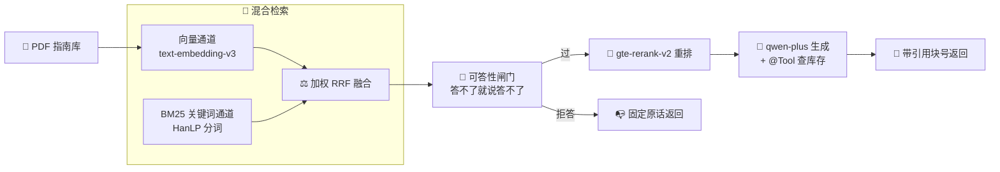
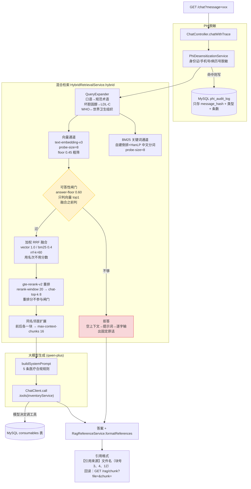
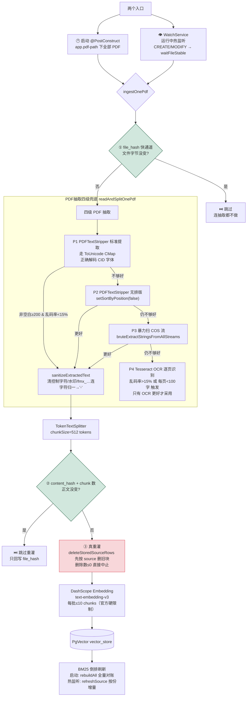

# 🏥 mkbAI · 医疗行业 RAG 智能助手


> **生产级混合检索 RAG 系统** · 58 道医疗考题端到端准确率 **98.4%**（60/61）· 答案块检索 Hit@1 从 **39.7% → 58.6%**



核心能力：

- 📚 **混合检索问答**：向量（text-embedding-v3, 1024维）+ 自建 BM25（HanLP 分词）→ 加权 RRF 融合 → 交叉编码器重排（gte-rerank-v2）→ 医疗合规约束生成
- ✅ **可答性闸门**：答不了就明说答不了，不编造。两道闸门（vector-floor 粗筛 + answer-floor 整体判定）在融合之前判
- 🔌 **Function Call 业务查询**：同一个 `/chat` 请求里，模型自己决定要不要调 `@Tool` 查耗材库存
- 📑 **引用溯源到块级**：答案末尾带「文件名 + 块号」，配套 `GET /rag/chunk` 可零成本回读原文 + PDF 物理页 + 页脚印码 + 章节号
- 🔐 **PHI 隐私合规**：身份证 / 病历号 / 手机号自动脱敏；审计落库只存 message_hash + 类型，**原文不进库**
- 🖼️ **扫描件 OCR 兜底**：P1 PDFTextStripper → P2 参数调整 → P3 暴力扫 COS 流 → P4 Tesseract OCR，四级抽取逐层降级
- 👁️ **目录热监听 + 三层判重**：运行中丢 PDF 自动入库，重复文件零计算；BM25 倒排按份增量刷新

---

# 🛠 技术栈

| 技术 | 版本 | 用途 |
|---|---|---|
| JDK | 21 LTS | 编译运行 |
| Spring Boot | 3.5.10 | 后端框架（父 POM） |
| Spring AI | 1.1.2 | ChatClient、VectorStore 抽象、`@Tool`、TokenTextSplitter、PagePdfDocumentReader |
| Spring AI Alibaba | 1.1.2.3 | DashScope 实现（ChatModel + EmbeddingModel） |
| 阿里云百炼 | qwen-plus / text-embedding-v3(1024维) / gte-rerank-v2 | 生成 / 向量化 / 交叉编码重排 |
| PostgreSQL + pgvector | PG 17 + pgvector 扩展 | 向量库（vector_store 表）+ 自建 BM25 倒排（bm25_docs / bm25_postings） |
| MySQL | 8.0 | 业务库（耗材库存 consumables 表 + PHI 审计 phi_audit_log 表） |
| Tesseract OCR | 5.x (chi_sim+eng) | 扫描件图像识别兜底 |
| HanLP | portable-1.8.4 | BM25 中文分词（词典打包在 jar 里，无需外部数据） |
| LangChain4j | 1.0.0-beta3 | 并存实验链路（`/lc/*`），与 `/chat` 走两套框架 |
| PDFBox | 随 Spring AI pdf-reader | PDF 文字层抽取 |
| JUnit 5 | — | 157 条纯逻辑单测，不连库不打模型 |

> 版本配套硬约束：Spring AI Alibaba 1.1.2.3 的 pom 里直接硬编码了 Spring Boot 3.5.10 + Spring AI 1.1.2，不要随意升级。

---

# 🚀 快速开始

## ⏩ 零 Key 零数据库：Docker Demo 档（推荐先试）

```bash
docker compose up --build
# 浏览器打开 http://localhost:8080
```

compose 起三个服务：pgvector/pg17、mysql:8.0、应用（`SPRING_PROFILES_ACTIVE=demo`）。Demo 档替换的只有**向量化**和**生成**两层外部调用，其余全部走正式链路：

| 环节 | Demo 实现 | 外部调用？ |
|---|---|---|
| 向量化 | 本地 `HashingEmbeddingModel`：字符 2-gram 哈希（1024 维、L2 归一化） | ❌ 无，`DemoModelConfig` 本地实现 |
| 生成 | 本地 `ExtractiveChatModel`：从提示词里逐句算字面重叠 + IDF 加权挑 3 句原文拼回 | ❌ 无，`DemoModelConfig` 本地实现 |
| PDF 抽取 / 切块 / 判重 / 热监听 | 原样 | — |
| 混合检索 / RRF 融合 / BM25 / 闸门 | 原样 | — |
| 重排 | 无 Key 自动跳过（配置项 `rerank-enabled: false`） | — |
| 引用溯源 / PHI 脱敏审计 / 评测 / `/rag/diag` | 原样 | — |

> ⚠️ Demo 档的闸门阈值（`vector-floor: 0.01` / `answer-floor: 0.05`）是按 2-gram 哈希向量的实测定的，和生产档真模型的 `0.45 / 0.60` **无可比性**（余弦量纲不同——一个比的是字面重叠，一个是语义相似度）。想看真实检索效果请用正式档 + 百炼 Key。

## 1️⃣ 环境要求

| 软件 | 最低版本 | 说明 |
|---|---|---|
| JDK | 21 | |
| Maven | 3.9+ | 仓库带 `mvnw` / `mvnw.cmd`（Wrapper 3.9.9，2026-11-04 本机实测可用），装了系统 maven 也可以直接用 |
| MySQL | 8.0 | 业务库；Demo 档用容器 |
| PostgreSQL | 17 + pgvector 扩展 | 向量库 + BM25 倒排；Demo 档用容器 |
| Tesseract-OCR | 5.3.3+ (chi_sim) | 扫描件识别；纯文字 PDF 可跳过 |
| Docker + Compose | 可选 | 只有 Demo 档需要 |

## 2️⃣ 数据库初始化

### PostgreSQL + pgvector（向量库 + BM25 倒排）

```sql
CREATE EXTENSION IF NOT EXISTS vector;
SELECT extname, extversion FROM pg_extension WHERE extname = 'vector';
```

`bm25_docs` 和 `bm25_postings`（自建 BM25 倒排表）由应用启动时自动创建，无需手动 DDL。

### MySQL（业务库）

```sql
CREATE DATABASE IF NOT EXISTS mkbAI
  DEFAULT CHARACTER SET utf8mb4 COLLATE utf8mb4_unicode_ci;

USE mkbAI;
CREATE TABLE IF NOT EXISTS consumables (
  id    BIGINT AUTO_INCREMENT PRIMARY KEY,
  name  VARCHAR(128) NOT NULL UNIQUE,
  stock INT NOT NULL DEFAULT 0
);
INSERT INTO consumables(name, stock) VALUES
  ('胃镜活检钳', 128),
  ('一次性输液器', 560),
  ('医用外科口罩', 20000);
```

`phi_audit_log`（PHI 审计表，只有四列 `message_hash / endpoint / hit_types / hit_count`）由应用启动时自动创建。

## 3️⃣ 安装 Tesseract OCR

1. 下载：https://github.com/UB-Mannheim/tesseract/wiki
2. 安装时勾选 **Chinese - Simplified (chi_sim)**
3. 把 `tessdata` 目录复制到 `D:/tessdata/`（避免 Program Files 权限问题）
4. 验证：`& "D:/Program Files/Tesseract-OCR/tesseract.exe" --list-langs` → 应输出 `chi_sim / eng`

## 4️⃣ 配置文件

项目用 Spring Profile 管理配置。公共项在 `src/main/resources/application.yml`，敏感项走本地覆盖文件（已 gitignore）：

```yaml
# src/main/resources/application-local.yml
spring:
  datasource:
    username: root
    password: <你的 MySQL 密码>
  ai:
    dashscope:
      api-key: <你的阿里云百炼 API Key>

app:
  pgvector:
    username: postgres
    password: <你的 PostgreSQL 密码>
```

> **没有环境变量占位符**。密钥只走 `application-local.yml` 明文覆盖，那个文件在 `.gitignore` 里——别提交它。

主配置 `application.yml` 关键段（完整权威版本见文件本身）：

```yaml
server:
  port: 8080

spring:
  ai:
    dashscope:
      chat:
        options:
          model: qwen-plus
          temperature: 0.7
      embedding:
        options:
          model: text-embedding-v3       # ⚠️ 默认 1024 维（v2 才是 1536 维）

app:
  pdf-path: D:/ai-docs                   # PDF 目录（启动扫描 + 运行热监听）

  retrieval:
    mode: hybrid                         # 生产只有 vector / hybrid；bm25、rerank 是评测口子专用
    probe-size: 8                        # 每一路先取多少条参与融合（8 比 20 在 top8 口径上答案块全覆盖 72.4% vs 62.1%）
    rrf-k: 60                            # RRF 平滑系数。论文常规值 60，实测 k=60 会把 BM25 top1 挤下去
    vector-weight: 1.0                   # 两路话语权
    bm25-weight: 0.4                     # 口语题 BM25 @1 只有 10.3%（向量 31.0%），等权会把向量中段挤掉
    vector-floor: 0.45                   # 向量通道粗筛。Java/电影类问题 top1 只有 0.39~0.44，正常题第 20 名还有 0.60~0.72
    answer-floor: 0.60                   # 可答性闸门，只判向量 top1。正常题 0.614~0.881，无答案题 0.388~0.568
    expand-neighbors: true
    chat-top-k: 8                        # 重排后截取
    max-context-chunks: 16               # 邻居扩展后上限
    rerank-enabled: true
    rerank-model: gte-rerank-v2
    rerank-window: 20                    # 送重排的候选数
    rerank-use-expanded-query: true      # 重排也看扩展后的术语串

  evaluation:
    report-dir: ./data/eval-reports      # 端到端评估跑完一轮，报告 JSON 顺手落这里（回执只在内存里，重启即失）

  pgvector:
    enabled: true                        # false = SimpleVectorStore 内存库
    dimensions: 1024                     # ⚠️ 必须严格匹配模型输出维度
    reset-table: false                   # 清空重建改 true 启动一次即可
```

## 5️⃣ 启动应用

```powershell
# 方式 A：IDEA Run 入口类 org.ragai.Main
#   VM options: -Dfile.encoding=UTF-8 -Dstdout.encoding=UTF-8 -Dstderr.encoding=UTF-8

# 方式 B：打包可执行 jar
mvn -DskipTests package
java -Dfile.encoding=UTF-8 -Dstdout.encoding=UTF-8 -Dstderr.encoding=UTF-8 `
     -jar target/mkbAI-1.0-SNAPSHOT.jar

# 方式 C：Maven 直接起
mvn spring-boot:run
```

✅ **启动成功标志**（关键日志）：

```
MysqlBusinessPool - Start completed.           ← 业务库池
PgVectorHikariPool - Start completed.          ← 向量库池
[PHI审计] ✅ phi_audit_log 就绪
[RagInitializer] Embedding 每批最多 10 个 chunks（DashScope 硬性限制）
[RagInitializer] 完成。成功PDF=N  chunks总数=M
[RagInitializer] BM25 重建完成：文档块=M  倒排条目=…  耗时=…ms
👁️ WatchService 已启动，监听目录：D:\ai-docs   ← 热监听
```

跑测试（157 条纯逻辑单测，几秒完成）：

```bash
./mvnw test          # Linux / macOS；Windows PowerShell 用 .\mvnw.cmd test
```

CI 每次 push 自动跑：仓库镜像在 GitHub（`zhenjb513/medical-rag`），`.github/workflows/ci.yml` 在 ubuntu / windows / macos 三档跑 `./mvnw test` + `package`，最新状态见顶部徽章。国内主仓仍是 Gitee（`origin`），Gitee 那侧不触发 GitHub Actions，所以两边都要推：本地分支叫 `master`，GitHub 的默认分支叫 `main`，命令是 `git push github master:main`。

## 6️⃣ 访问 Web 界面

启动后打开 **http://localhost:8080**

前端源码在 `src/main/resources/static/`（纯 HTML + CSS + 原生 JS，零构建）。三个 Tab：

| Tab | 功能 |
|---|---|
| 💬 智能问诊 | RAG 问答（SSE 流式）/ Tool Call 查库存 / PHI 脱敏 / 多轮上下文 |
| 🧪 系统评估 | 一键跑 61 题测试集（58 可答 + 3 超纲），输出四维评估 |
| 🩻 运行诊断 | `GET /rag/diag` 可视化：向量库状态、OCR 就绪、入库流水、BM25 对账 |

### 智能问诊


答案和引用行逐字来自 2026-10-22 那次 4 题评估的服务端日志（真 qwen-plus + 真库那 4 份指南；日志是本地留档，没入库），上面这张是把该响应按 SSE 帧喂给前端自身的流式渲染路径截的图——**截图过程没有调用模型**。

### 系统评估


报告为 2026-10-22 的 **4 题小样本**子集（`subset_filter`，全 4 过），所以页面顶栏写 61 题考卷、卡片写 4/4。全卷 60/61 的那次在下面「评测体系 → 两套指标，口径不同」。

### 运行诊断


2026-11-05 本机真实后端的 `/rag/diag` 响应原文渲染：PgVectorStore、501 块 / 4 份、BM25 501 docs、OCR 就绪，逐份体检的 `77/77 184/184 167/167 73/73` 是「库里块数 / 磁盘重抽块数」对上了才算齐。

---

## 7️⃣ 可观测性栈（Prometheus + Grafana，可选）

应用自己已经把指标吐在 `GET /actuator/prometheus`（Micrometer）；看板要另外起两个容器，一条命令：

```bash
bash docker/up-monitoring.sh        # 只起 Prometheus + Grafana
docker compose up -d                # 或者连 redis / rabbitmq / app 一起起
```

| 入口 | 地址 | 说明 |
|---|---|---|
| Grafana 看板 | http://localhost:3000 （`admin`/`admin`，也开了匿名读） | 「RAG mkbAI 可观测性看板」`/d/rag-custom`，10 个面板 |
| Prometheus | http://localhost:9090/targets | job `mkbai-app` 应当是 `up`，几百条时间序列 |

看板覆盖：流式请求按结果分组（completed / error / cancelled）、TTFT 与整段耗时的 p50/p95/avg、LLM token 用量、JVM 堆、HTTP QPS、HikariCP 连接池活跃/空闲/上限、RabbitMQ 连接与信道、Resilience4j 熔断状态、限流可用令牌。

配置全在仓库里，容器只挂这几份文件，改完重跑 `docker compose up -d prometheus grafana` 就生效：

```
docker/prometheus/prometheus.yml                        抓取目标（15s）
docker/grafana/provisioning/datasources/prometheus.yml  数据源 → http://prometheus:9090
docker/grafana/provisioning/dashboards/provider.yml     看板目录提供者
docker/grafana/dashboards/rag-custom.json               看板本体
```

两个坑，写死就会静默没数据：

1. **抓取地址别写死 IP。** 容器里 `host.docker.internal` 要指到跑应用的那台机器：Docker Desktop 的引擎认 `host-gateway`，纯 WSL2 里跑的 docker engine 不认（实测解析成网桥 `172.17.0.1`，连不上宿主的 8080），那边得用默认路由的下一跳。`docker/up-monitoring.sh` 没给 `WINDOWS_HOST_IP` 时自动按默认路由取一次，Compose 里是 `${WINDOWS_HOST_IP:-host-gateway}`。
2. **Grafana 的数据源同理。** 这份配置以前写的是 Prometheus 的网桥 IP，容器重启换址后数据源直接 `connection refused`，看板一片空白——所以现在是服务名 `prometheus`。

看板文件是「源」，UI 里的临时改动不会回写仓库（`allowUiUpdates: true`，文件变更 10s 内会覆盖回来）；要留住改动就改 `docker/grafana/dashboards/rag-custom.json`。`/var/lib/grafana` 挂在命名卷 `grafana-data` 上，容器删了 UI 里建的东西还在。

> `admin`/`admin` 和匿名 Admin 只是本机 demo 用的，对外演示前自己换掉或关掉。

---

# 🧱 架构总览

## 问答链路（`GET /chat`）



**两道闸门的位置**（Mermaid 图里黄色菱形）：

- `vector-floor: 0.45` — 向量通道取数时的粗筛，把明显不沾边的候选挡在融合前
- `answer-floor: 0.60` — **融合之前**、只判向量通道第 1 名的余弦。不够就整批不给上下文，直接拒答

重排分**不参与**可答性判定（gte-rerank-v2 的分数量纲和向量余弦不同，拿它当判据会错放错杀）。

配套的零模型调用运维口子：

- `GET /rag/chunk` — 块号 → 原文 + PDF 物理页 + 页脚印码 + 章节号
- `GET /bm25/search | df | locate | rebuild` — BM25 关键词索引运维
- `GET /rag/diag` — 全链路体检 JSON

## 知识库构建（`RagInitializer`）



**三层判重机制**（绿色菱形）：

| 层 | 判据 | 结果 | 源码位置 |
|---|---|---|---|
| ① file_hash | 文件字节 SHA-256 | 完全跳过抽取，零计算 | `RagInitializer.ingestOnePdf` |
| ② content_hash + chunk 数 | 清洗后正文 SHA-256 + 切块数量 | 跳过重灌，只回写 file_hash | `RagInitializer` metadata |
| ③ 重灌前删旧块 | `DELETE FROM vector_store WHERE metadata->>'source' = ?` | 删除数≤0 → 中止，绝不允许同一份文件出现两套 chunk_index | `deleteStoredSourceRows` |

**BM25 按份增量刷新**：启动时走 `rebuildAll` 全量对账（501 块实测 1.6~1.8s），热监听入库走 `refreshSource(这一份)`——代价只跟这份块数成正比（73 块实测 737ms），不再每份付一次全表重建。全量与增量共用同一个 `Bm25RowBuilder`，两条路不可能算出两套行。

**WatchService 去抖**：Windows 复制文件先 CREATE 再 N 次 MODIFY（文件写了一半），`waitFileStable` 等文件大小稳定才处理。

**PDF 抽取流水线版本**：`EXTRACT_PIPELINE_VERSION` 常量写在 metadata 里，换抽取算法后启动时会自动重灌所有旧块。

---

# 🔍 检索链路详解

## 混合检索（向量 + BM25，加权 RRF 融合）

**为什么不直接把分数相加**：向量分是 0~1 的余弦，BM25 分是 5~60 的无上限量，两边阈值也完全不同（实测域外问题在向量侧 0.39~0.66、在 BM25 侧照样能拿 20 分）。所以只比较**名次**——RRF（Reciprocal Rank Fusion）：

```
score = Σ weight / (rrfK + rank)
```

- `rrf-k=60`：论文常规值，k 越大越民主（只看是否两边都在），k 越小越独裁（任一路的第一名就能定序）
- `vector-weight: 1.0 / bm25-weight: 0.4`：58 题实测，口语化提问下 BM25 答案块命中 @1 只有 10.3%（向量 31.0%），等权融合会把向量排好的中段挤掉（前 4 名 65.5%→48.3%），所以关键词这路要降权

## 可答性闸门（answer-floor 0.60）

**为什么对第一名做整体判断而不是逐条砍**：以前每条低于 0.65 就丢掉，实测 58 题里，那道逐条阈值会把「每日食盐摄入量」这种正确题的 20 条候选砍到只剩 2 条，却照样放行库里确实没答案的题（「火星上有没有心血管指南」top1=0.660）。

改成对第一名做整体判断后：

| 类别 | top1 余弦范围 |
|---|---|
| 库里有答案、正常提问 | 0.614 ~ 0.881 |
| 库里确实没答案（肺癌手术/脑瘤/Java/电影） | 0.388 ~ 0.568 |

一条 0.60 就能分开。唯一漏网的是火星题（top1=0.660），那是任何检索分数都分不开的，只能靠生成期校验。

闸门**在融合之前判**——一旦 RRF 之后分数是名次凑出来的，就没法拿来当「像不像」的依据了。

## gte-rerank-v2 交叉编码器重排

58 题实测（同一批候选，只差排序）：

| 指标 | 重排前 | 重排后 |
|---|---|---|
| 答案块 @1 | 39.7% | 58.6% |
| 答案块 @2 | 55.2% | 72.4% |
| 答案块 @4 | 67.2% | 77.6% |
| @8 / @20 | 完全不变 | 完全不变 |

**重排不召回新东西，只把已经在池子里的正确答案往前搬**，而进提示词的正是前几名。口语化提问也一起涨（@1 27.6%→44.8%），因为交叉编码器看的是「这段有没有回答」而不是「词有没有对上」。

代价：每题多一次外网调用（实测 150ms→344ms/题）；调用失败自动退回融合顺序，不会把问答搞挂。

`rerank-window: 20` — 重排只能在池子里换座位，池子多大它就最多能救多远的块。

**重排查不查也看扩展后的术语串**（`rerank-use-expanded-query: true`）：口语题「我血糖偏高」用原话重排时，四个答案块（《中国血脂管理指南2023年》#90/#91/#92 + 《中国心血管病一级预防指南2020》#72）一个都进不了 16 块上下文；开了扩展后 #89 从第 8 名升到第 4 名，它的邻居 #90 因此拿到名额进上下文，三道含触发词的口语题端到端全过。其余 56 题查询串一个字都不变。

## QueryExpander 口语 → 规范术语

患者口语里的词和指南里写的不一样：

| 口语措辞 | 补入的指南术语 |
|---|---|
| 坏胆固醇 | LDL-C / 低密度脂蛋白胆固醇 |
| 血糖偏高 | 糖尿病 / 血糖异常 |
| 全家 | 家族史 / 遗传因素 |
| WHO | 世界卫生组织 |

补进去的术语同时送给**召回通道**（向量 + BM25）和**重排通道**（当 `rerank-use-expanded-query: true`），但**不送给生成模型**——模型看见什么问什么，术语桥只在检索侧工作。

## 邻居扩展（expand-neighbors）

指南里「140/90」这类数值常在表格里被切开，命中块本身句子不完整。把命中块的前后各一块补进上下文，总块数不超过 `max-context-chunks: 16`，名额不够时按命中块名次优先。

## 为什么弃用 QuestionAnswerAdvisor 改手动控制

Spring AI 自带的 `QuestionAnswerAdvisor` 只有一次 `similaritySearch`，阈值和上下文组装全吞进去了。而本项目需要：

- 闸门在 BM25 融合**之前**判
- 引用落到**块级**（chunk_index）
- QueryExpander 在**检索前**介入
- 重排失败能**退回**融合顺序
- 零成本回读口子 `/rag/chunk` 要拿到**准确的块号**

Advisor 任何一条都满足不了。手动链路在 `ChatController.chatWithTrace()` 里一行一行走，每一步都留了日志。

---

# 📑 引用溯源：块号 → 物理页 → 章节号

答案末尾的引用行格式：`【引用来源】国家基层高血压防治管理指南2025版.pdf（块号 8、17）`

回读接口 `GET /rag/chunk?file=&chunk=8` 不调任何模型，直接返回：

```
文件=国家基层高血压防治管理指南2025版.pdf  块号=8  source=D:\ai-docs\国家基层高血压防治管理指南2025版.pdf  正文字符=412
页码=物理页 14~15（页脚印码 "14"）
章节=跨节：2.2 临床表现 → 2.3 高血压诊断
---- 正文 ----
...（该 chunk 的完整原文）...
```

**页码和章节号都是现算的，不入库**——入库是整篇抽成一条流再切块，metadata 只有 `page_count`；存页码要重灌库。现算方式：按块号所在的文件重抽一遍 PDF 正文（`PdfPageLocator.locate`），逐页比对字符串偏移来定位物理页；同时在同一文本里扫章节号正则（`SectionIndex.locateSection`）。

**章节号宁缺毋滥**：认不出来就明说、绝不猜；跨节报范围；4 块顺序存疑就整行不给号。给错号比不给更坏——人会照着去翻。

---

# 🔐 PHI 隐私合规

`PhiDesensitizationService.desensitize()` 在进入检索和大模型之前对用户输入做脱敏：身份证号、手机号、病历号等用占位符替换（身份证保留前 3 后 4、手机号保留前 3 后 4）。

`PhiAuditService` 审计落库只写四列：

| 列 | 内容 |
|---|---|
| message_hash | 原句 SHA-256 |
| endpoint | `/chat` / `/lc/chat` 等 |
| hit_types | `身份证:1, 手机号:2` 这种 |
| hit_count | 总数 |

**原始问句和脱敏后文本都不进库**——存原文=聊天日志，本身就是一次数据泄露。以前的 `println` 会把含身份证的整条原话写进日志，现在那个泄露口子已堵。

---

# 📋 HTTP 接口总览

全部是 `GET`，无鉴权——本地 Demo 别直挂公网。

## 核心问答

| 接口 | 模型调用 | 干什么 |
|---|---|---|
| `GET /chat?message=` | 向量化 + 重排 + 生成（过闸门时） | 主问答：PHI 脱敏 → 混合检索 → 闸门 → 重排 → 邻居扩展 → 生成 + 引用拼接 |
| `GET /rag/chunk?file=&chunk=` | **无** | 引用回读：原文 + PDF 物理页 + 页脚印码 + 章节号 |
| `GET /rag/diag?deep=` | **无** | 运行时体检 JSON：VectorStore 类型、OCR 就绪、入库流水、BM25 对账、PHI 审计表、库存 DB 连通、PgVector 状态 |

## 评测

| 接口 | 模型调用 | 干什么 |
|---|---|---|
| `GET /evaluation/recall?probeK=&mode=&expand=` | bm25 零调用，其余每题 1 次向量化；rerank 再加 1 次 | 检索级基线：答案块排第几名（Hit@K / MRR） |
| `GET /evaluation/retrieve?q=&topK=` | 向量化（开重排时多 1 次） | 生产链路真实召回了哪些块 |
| `GET /evaluation/select?only=` | **无** | 列出 `/evaluation/run` 会跑到哪些题（付费前预演） |
| `GET /evaluation/run?only=` | 每题向量化 + 重排 + 生成 | 端到端四维评估，提交即返回 taskId（异步，全量实测 394s） |
| `GET /evaluation/status/{taskId}` | **无** | 取回执：RUNNING 只给已耗时，DONE 给完整报告 + 落盘路径 |
| `GET /evaluation/summary?only=` | 同上 | ⚠️ 内部会**重跑一遍**评估（非缓存），必须带 `only=` |

> `/evaluation/run` 跑完的那份报告**同时写文件**：`app.evaluation.report-dir`（默认 `./data/eval-reports`），
> 文件名 `report-<时刻>-<taskId>.json`，内容与 `/evaluation/status` 的 `report` 字段逐字一致。
> 理由很实在：回执只在内存里，重启即失，而一次全量的钱已经花掉了（2026-10-12 那次就是客户端超时丢了一整轮明细）。
> 写不进去只打一条 warn，不会把跑完的评估判成 FAILED。

> `/evaluation/recall?mode=` 分档说明：只有 `mode=bm25` 是零模型调用；`vector` / `hybrid` / `rerank` 都要打向量通道，`rerank` 再加一次重排。别一律当免费口子用。

## BM25 运维（`Bm25Controller`）

| 接口 | 干什么 |
|---|---|
| `GET /bm25/search?q=&topN=` | 关键词试查（bm25 分 + 命中块号） |
| `GET /bm25/df?term=` | 词在库里出现在多少块（df=0 = 语料里没这个写法） |
| `GET /bm25/locate?phrase=&limit=` | **原文逐字定位**（考卷答案块标注用的） |
| `GET /bm25/rebuild` | 手动全量重建兜底 |

## LangChain4j 并存实验（`/lc/*`）

> 这组**不接 RAG 检索链路**，是 LangChain4j AiServices + `@Tool` 用法演示，和 `/chat` 走两套框架。

| 接口 | 场景 |
|---|---|
| `/lc/chat` | 医疗耗材助手角色 |
| `/lc/chat/doctor` | 心内科主治医师（纯模型知识） |
| `/lc/chat/safe` | Prompt Injection 防御（红队测试） |
| `/lc/chat/json` | 固定 JSON 结构化输出 |
| `/lc/tool/inventory` | 只挂库存 `@Tool` |
| `/lc/tool/phi` | 只挂 PHI 脱敏 `@Tool` |
| `/lc/tool/full` | 两个工具一起挂 |

---

# 📊 评测体系

## 测试集（`src/main/resources/eval/medical_test_set.json`）

61 题考卷，按问法成对覆盖。每份指南的答案块标注用 `/bm25/locate` 原文逐字定位得到（不是猜测）：

| 维度 | 说明 |
|---|---|
| 事实查询 | 书面问法，如「高血压降压目标是多少？」 |
| 口语查询 | 患者口吻，如「血压一直高降不下去怎么办」—— 不带原文术语，用来量「自造题偏袒关键词检索」 |
| 综合分析 | 多因素综合题 |
| 超纲负样本 | 3 题（该拒答的：火星上有没有心血管病防治指南、如何手术治疗肺癌、45 岁头疼是不是得了脑瘤） |

考卷是数据文件不是 Java：`sections` 按问法分三段、`answerGroups` 存「文件名#块号」标注和每条标注当初是逐字核对出来的原因。书面题和口语题共用同一个 `answerGroup`，加题只在对应段落追加一个对象，别把 ground truth 抄两份。`MedicalTestSet.java` 只剩读 JSON 的 89 行。

考卷覆盖 4 份临床指南，**共 501 块**（chunkSize=512 tokens）：

| 文件 | 说明 |
|---|---|
| 中国心血管病一级预防指南2020.pdf | 主覆盖 |
| 国家基层高血压防治管理指南2025版.pdf | 基层实践版本 |
| 中国血脂管理指南2023年.pdf | 含 LDL-C / 非 HDL-C 目标值 |
| 02-WHO成人高血压药物治疗指南2021.pdf | 英文指南，QueryExpander 中英文桥命中用 |

每份指南的实际块数按入库时 TokenTextSplitter 的切分结果为准，重灌库会变化——考卷的答案块标注（`文件名#块号`）每次重灌后用 `/bm25/locate` 原文逐字重标。

## 四维判定口径

| 维度 | 判定逻辑 | 源码 |
|---|---|---|
| **答案准确性** | 三选一：① 预期关键词在答案里命中 + 在本次上下文里出现；② 出处就是考卷标注的答案块（`answerChunks`）；③ 考卷标注的关键词在答案里出现 + 该关键词所在的块号也在本次上下文里 | `AccuracyJudgeTest` |
| **引用正确性** | 答案里出现了 `【引用来源】` 且引用的文件名列表非空 | `ChunkCitationTest` |
| **幻觉抑制** | 答案里没有明显的外部知识（如电影名、流行语） | `EvaluationService` hallucinationPass |
| **合规性** | 按小句判定：诊断措辞不用第一人称（「我觉得」「我推荐」）、高血压目标用「应控制在」等条件标记而不是「必须」 | `ComplianceJudgeTest` |

两类可疑标记（帮助定位「看着像对其实不对」的情况）：

| 标记 | 含义 |
|---|---|
| `backfillSuspect` | 关键词只在答案里出现、上下文里没有 → 模型在用自己的知识替库背书 |
| `wrongBlockSuspect` | 关键词有出处、但出处落在考卷标注的答案块**之外**的块上 → 检索找回了同一份指南里无关的段落 |

## 两套指标，口径不同

| 层次 | 衡量什么 | 现行基线 |
|---|---|---|
| **检索级** `/evaluation/recall` | 标注的答案块排第几名（Hit@K / MRR） | `mode=hybrid` 关重排：**Hit@1 39.7% / @8 96.6%，MRR 0.543**（58 题 ground-truth 实测，application.yml L73 注释）；开重排后 @1 提至 **58.6%**，MRR **0.691** |
| **端到端** `/evaluation/run` | 最终答案过不过四维判定 | **60/61 = 98.4%**（2026-10-16；唯一挂的 1 道合规误伤已在口径修复后通过） |

> ⚠️ 换口径前后的分数不可直接比较——是换了尺子不是模型退步。重排收益（@1 从 39.7% → 58.6%）是旧库 507 块 + 旧块号下量的，新库（501 块）同口径带重排的端到端数字还没跑。

端到端评估一跑起来每道题是三次付费调用（向量化的查询 + 重排 + 生成），全卷 61 题实测 392 秒。所以先用 `/evaluation/select?only=` 零成本确认选中的到底是哪些题，再决定跑。

---

# 🧪 单元测试（157 条，纯逻辑）

全部在 `src/test/java/`，**不连数据库、不调模型、不依赖任何外部服务**。每条测试验证的是纯逻辑判定：

| 类 | 条数 | 守什么 |
|---|---|---|
| `AccuracyJudgeTest` | 12 | 准确性三口径：关键词命中 + 在上下文中 + 出处命中考卷答案块 |
| `ComplianceJudgeTest` | 8 | 合规按小句判定诊断措辞（人称 + 条件标记） |
| `EvalNormalizeTest` | 5 | 匹配归一化只管空白和连字符家族，**不动标点** |
| `EvalPromptGuardTest` | 5 | 拒答原话逐字命中、提示词与判分器共用同一常量 |
| `EvalSummaryCaliberTest` | 4 | 报告 summary 里三条口径行 + 两类可疑计数 |
| `MedicalTestSetStructureTest` | 6 | 考卷结构（58 可答 + 3 负样本）、题量、块主键格式、书面/口语共用同一份标注 |
| `RetrievalModeGuardTest` | 8 | 模式降级表（bm25→hybrid、不认识→vector+警告） |
| `ChunkCitationTest` | 10 | 引用行形状：文件名排最前 + 块号列表 |
| `PdfPageLocatorTest` | 23 | 块号→物理页 / 页脚印码：偏移不一致不给、歧义跳过、不猜 |
| `SectionIndexTest` | 22 | 块号→章节号：形状闸门 + 大纲单调性 + 跨节给范围 |
| `InventoryToolVerdictTest` | 5 | 库存工具返回值四态：有货 N 件 / 未登记 / 查询不可用 / 没给名称 |
| `PhiAuditRowTest` | 7 | 审计行只有四列，任何一列**不许**出现原文 |
| `Bm25RowBuilderTest` | 7 | 全量与增量共用同一套行构造、零 term 块也落 doc 行 |
| `DemoExtractiveModelTest` | 8 | Demo 档本地模型守值：拒答逐字、2-gram 哈希向量可复现且 L2 归一 |
| `InventoryToolSchemaTest` | 9 | 库存工具的**说明书**：名字字符集、描述不退化成方法名、参数进 `required`、schema 键名能映射到形参、缺参不许报出件数 |
| `MultiHopRetrievalServiceTest` | 5 | 多跳触发与合并：单实体问句不触发、显式 AND 与「首轮跨 ≥2 份来源」必须触发、合并按 content_hash 去重、开关关了直接委托单跳 |
| `ApiKeyFilterTest` | 8 | 白名单分档：只读免凭据 / 会花钱或会写要凭据、限流在鉴权之前、`/actuator` 不限流、`/app.js`+`/style.css` 必须放行 |
| `EvaluationTaskServiceTest` | 5 | 异步评估回执：报告 JSON 与同步时代逐字一致、DONE 后取到全文、一轮在跑时重复提交不开第二份钱、DONE 的报告落盘且与回执逐字一致、落盘写不进去不许改判 FAILED |

---

# ⚠️ 关键设计取舍（直接引源码注释）

> 下面每条都能在对应源码文件的类头注释或字段注释里找到完整的实测依据。这里只列结论。

| 决策 | 为什么这么做 | 源码 |
|---|---|---|
| **混合检索而非纯向量** | 向量对精确术语/缩写不稳，BM25 对口语化/同义词不稳；融合比单通道好 | `HybridRetrievalService` 类头 |
| **BM25 权重 0.4** | 口语题 BM25 答案块 @1 只有 10.3%（向量 31.0%），等权会把向量中段挤掉（前4名 65.5%→48.3%） | `application.yml` L80-83 |
| **RRF 用名次不用分数** | 向量余弦和 BM25 分量纲根本不可比，名次比较才有意义 | `HybridRetrievalService` L263-288 |
| **answer-floor 只判向量 top1** | 闸门要在融合之前判（一旦 RRF 之后分数是名次凑出来的），且只判向量通道有意义的余弦 | `HybridRetrievalService.hasEvidence` |
| **重排分不参与闸门** | gte-rerank-v2 的分数量纲和向量余弦不同，拿它当判据会错放错杀 | `application.yml` L122-124 |
| **queryExpander 在检索侧补术语** | 患者口语（「坏胆固醇」「血糖偏高」）在指南里写的是规范术语；中英文桥让 WHO 那份英文指南能被中文问句召回 | `QueryExpander` |
| **库存工具返回文字分态** | 以前异常一律吞成 0，模型答「缺货」，实则连错库；现在分「有货 N 件 / 未登记 / 查询不可用 / 没给名称」——最后一条是 2026-11-04 补的，实测 Spring AI 1.1.2 不校验 schema 的 `required`，模型缺参调用照样进方法，空串名去查会被误报成「库里没登记」 | `InventoryService` |
| **PHI 审计只存四列、不落原文** | 存原文=聊天日志，本身就是一次数据泄露；只存 message_hash + 类型:条数就够了 | `PhiAuditService` |
| **弃用 QuestionAnswerAdvisor 改手动** | Advisor 只有一次 similaritySearch，本项目需要：闸门在 BM25 融合之前、引用落到块级、QueryExpander 介入、重排失败能退回 | `ChatController` L65-67 |
| **页码/章节号读时现算不入库** | 入库是整篇抽成一条流再切块，metadata 只有 page_count；存页码要重灌库 | `PdfPageLocator` / `SectionIndex` |
| **章节号宁缺毋滥** | 认不出来就明说、绝不猜；4 块顺序存疑就整行不给号——给错号比不给更坏 | `SectionIndex.describe` |
| **WatchService 处理 CREATE/MODIFY，不处理 ENTRY_DELETE** | 删档钩子没实现，PDF 被外部删掉后向量库和 BM25 倒排里的旧块不会自动清理 | WatchService 线程 |
| **DashScope Embedding 每批 ≤10** | 官方硬限制，`DASHSCOPE_EMBEDDING_MAX_BATCH = 10` | `RagInitializer` L98 |
| **PDF 不用 Spring AI 的 PagePdfDocumentReader** | 其版面坐标排序 Comparator 不满足 Java TimSort 合约，复杂 PDF（双栏/表格/OCR 扫描件）会抛 `Comparison method violates its general contract` | `RagInitializer` 类头 |

---

# ❓ 常见问题

## Q1：启动时报 `expected 1536 dimensions, not 1024`

向量表列维度和 Embedding 模型输出维度不匹配。DashScope `text-embedding-v3` 是 **1024 维**，`text-embedding-v2` 才是 1536 维。

解法：改 `app.pgvector.dimensions: 1024` 对齐模型。`PgVectorSchemaInitializer` 会在启动时自动检测维度不匹配并 DROP TABLE 重建。旧数据会清空，向量重灌。

## Q2：为什么换 chunkSize 必须重灌库？

改了切分粒度块数必然变，三层判重的第③层（`content_hash + chunk 数`）会判成不同 → 自动走重灌分支（先按 source 删旧块再灌）。

粒度必须统一：混两种块长时向量分数不可比（`vector-floor` / `answer-floor` 这些阈值全是在特定粒度下实测出来的）；考卷标注的 `文件名#块号`、引用行块号也全部要重标。

## Q3：答案里有 `**` 星号

System Prompt 没有「不要用 Markdown」约束，前端也**不渲染 Markdown**（`textContent` 原样写入）。可选修法：① 答案返回前加正则清洗（改 `ChatController`）；② 在提示词里加纯文本约束（需先过 `EvalPromptGuardTest`）。

## Q4：扫描件 OCR 报 `exit=1`

大概率是 `chi_sim.traineddata` 找不到或 Program Files 权限不够。先看 `GET /rag/diag` → `rag_initializer.ocr` 的 `diag_line` 找具体路径。代码按四级顺序找 tessdata（配置目录 → `D:/AI/mkbAI/.diag-tmp/dl` → `%USERPROFILE%/tessdata` → 自动复制到 `D:/tessdata`）。

## Q5：引用块整段留在答案气泡里

历史上是 `splitAnswer()` 找旧标记 `【引用(参考)来源】`、后端早已改成 `【引用来源】`，两边对不上——这条 2026-10 已修（现在两边都是 `【引用来源】`）。

2026-11-05 补了流式那条链路的两个同类毛病（都在 `src/main/resources/static/app.js`）：

- 流打完后 `removeStreamingBubble()` 把整条消息删掉了，页面只剩提问气泡，答案闪一下就没。改成 `finishStreamingBubble()`：只摘 `id="streamingMsg"` 标记，内容留下。
- SSE 一帧里多行 `data:`（引用块就是多行）被 `data += ...` 直接拼成一行，引用行全挤在一起。改成先收进数组再按 `\n` join，符合 SSE 规范的分帧方式。

引用块开头那两行空白和 `---` 分隔线是 `formatReferences()` 的文本本身带的，前端照原样渲染，没动。

## Q6：两个数据源、两个 JdbcTemplate

`PgVectorConfig` 注册了 `pgVectorJdbcTemplate` 后，Spring Boot 的 `JdbcTemplateAutoConfiguration`（`@ConditionalOnMissingBean`）就不会再生成 MySQL 侧的连接池——这就是历史上库存工具连错库的根因。现在 `MysqlBusinessConfig` 显式补了 `businessJdbcTemplate`，两边都**不标 `@Primary`**，新写服务要哪个库必须 `@Qualifier("businessJdbcTemplate")`（MySQL 业务）或 `@Qualifier("pgVectorJdbcTemplate")`（向量库）。

## Q7：检索模式配成 bm25 或 rrf-k 想要更小

`mode=bm25` 会自动降级成 hybrid（`HybridRetrievalService.enforceGateCapable`），纯关键词命中没有余弦，可答性闸门判不了。`rrf-k` 论文常规值是 60，但本库里 BM25 的 top1 恰恰最准，k 越小越容易让它被挤下去——实测 k=60 和 k=10 结果几乎一样，所以留 60。

## Q8：怎么测 BM25 单边的检索质量？

用零调用口子 `GET /evaluation/recall?mode=bm25&probeK=20`。这个模式绕开向量通道，不打任何模型接口。别配进 `app.retrieval.mode`（会被降级）。

---

# 📜 版本兼容性

| 组件 | 版本 | 备注 |
|---|---|---|
| JDK | 21 | 必须 |
| Spring Boot | 3.5.10 | 父 POM，硬约束 |
| Spring AI | 1.1.2 | ChatClient / VectorStore / @Tool |
| Spring AI Alibaba | 1.1.2.3 | DashScope 实现，**硬编码依赖 Boot 3.5.10 + Spring AI 1.1.2** |
| LangChain4j | 1.0.0-beta3 | `/lc/*` 实验链路；社区 BOM |
| pgvector JDBC | 0.1.6 | 客户端驱动版本 |
| MySQL Connector | 9.5.0 | |

---

# 🚀 后续优化方向

| 优先级 | 方向 | 说明 |
|---|---|---|
| P1 | 大库规模化 | 现在只有 4 份指南 / 501 块，BM25 已改按份增量，但没在千份级库上压过检索与重建 |
| P2 | 句子级溯源 + 多跳题考卷 | 引用到块为止、多跳题没被测过（库太小，top-16 已经盖住全部答案块） |
| P2 | 知识库版本治理 | metadata 里没有生效日期，也没有 `superseded_by`（已 grep 确认）：多版指南并存时检索把两份当平级来源，可能引过期那版且完全静默 |
| P2 | 推荐类别 / 证据等级溯源 | 表格压平后「每条推荐 ↔ 它的等级」在抽取那一刻就丢了，做这个要换表格感知抽取 = 重灌库 |
| P3 | 账号体系 | 用户来自配置文件里的内存 `InMemoryUserDetailsManager`，没有注册、角色、多租户；公网直挂仍需前置网关 |
| P3 | 多格式文档 | Word / Markdown / Excel |

已经不再是缺口（2026-11-05 对着代码逐条核过，别再当 TODO 列出来）：Maven Wrapper、CI 真正生效（GitHub 镜像上三 OS 全绿）、
SSE 流式（`GET /chat/stream`）、多轮上下文（`ChatMemoryManager`）、鉴权与限流收口（`ApiKeyFilter` + Spring Security）、
删除文件时的向量/BM25 清理（`RagInitializer.handleSourceFileDelete`）、前端引用块拆分（`splitAnswer()` 的标记串与后端 `【引用来源】` 一致）。

---

# 📄 License

本仓库的代码、评测考卷与文档用 **PolyForm Noncommercial License 1.0.0** 授权（完整条款见 [LICENSE](LICENSE)，
SPDX 标识 `PolyForm-Noncommercial-1.0.0`）：**可以读、可以改、可以拿去做研究和自托管验证，不得用于商业用途**。
要商用得另外找我拿授权。

条款里几条实操上会碰到的，先翻译成人话：

- **允许**：个人学习、研究、面试演示、以及学校 / 公益 / 公共卫生机构的使用（哪怕这些机构有经费来源也算非商业）。
- **分发时**必须把这份条款（或它的 URL）一起给下去，并保留 `Required Notice` 那两行署名。
- 改出来的新作品仍受同一份限制，不能商用，也不能再往下授权别人。
- 按"原样"提供，不构成医疗建议，不是医疗器械，使用者自担风险。

还有一层边界要说清楚：**临床指南原文不在这个仓库里**。`data/pdfs/` 那两份是脚本合成的示例 PDF，
只用来让 demo 档开箱能跑出结果；评测实际依赖的 4 份正式指南（一级预防 / 基层高血压 / 血脂管理 / WHO）
版权归各自发布机构所有，需要你自己合法取得后放进 `app.pdf-path` 指向的目录。本仓库的授权覆盖不到那些原文。